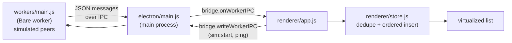
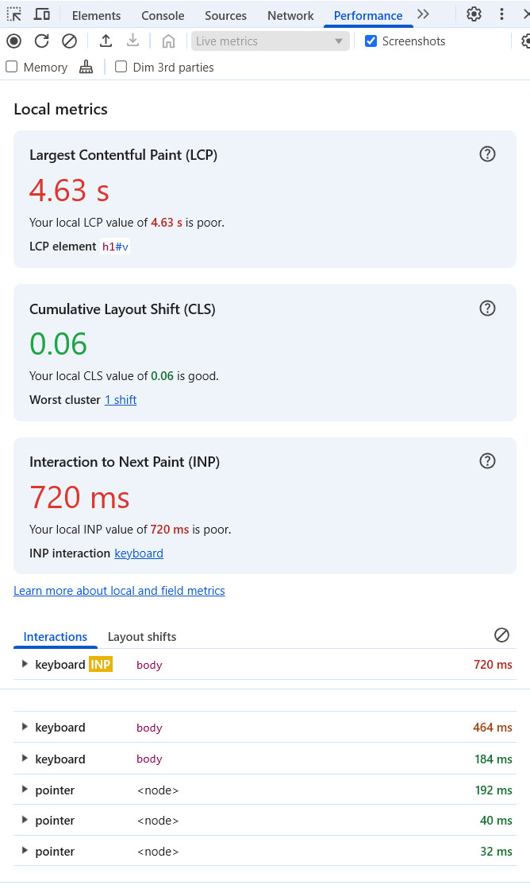
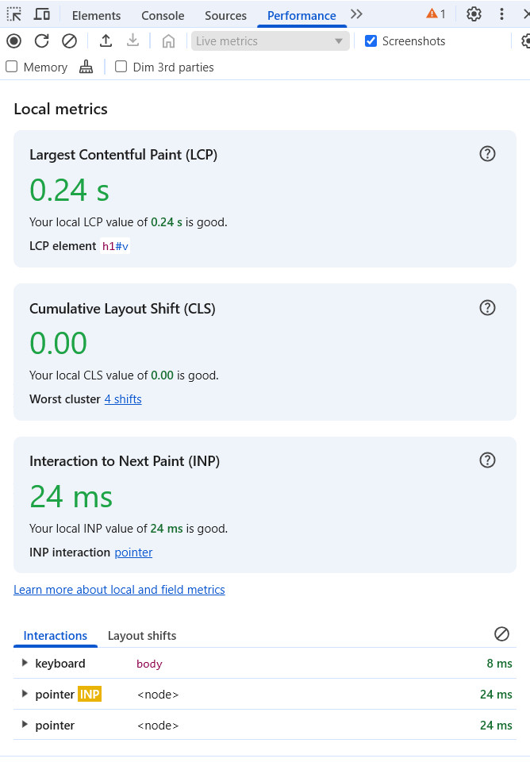
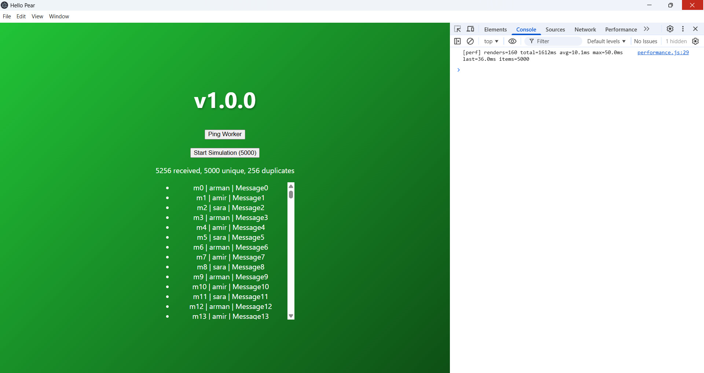
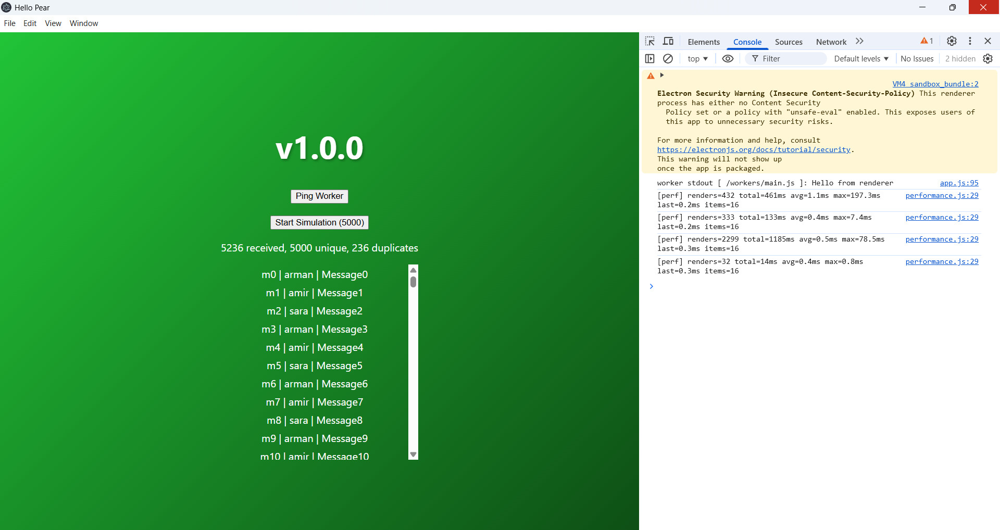

# Pear Renderer Lab

A hands-on experiment built on top of [hello-pear-electron](https://github.com/holepunchto/hello-pear-electron): how should a desktop UI behave when its data comes from a peer-to-peer network, where messages arrive **late, out of order, and more than once**?

This repo simulates that situation and walks through four steps to keep the UI correct and fast:

1. A worker that simulates unreliable peers
2. A naive list that shows the problems
3. A small message store that fixes ordering and duplicates
4. A virtualized list that keeps rendering cost flat

> **Disclaimer:** this is an independent learning project. It is not affiliated with, endorsed by, or an official project of Holepunch, Pear, Keet, or Tether. It started from the official `hello-pear-electron` template; see [License](#license).


## Simulation Demo

The animation below shows the full 5,000-message simulation,
including out-of-order delivery, duplicate messages,
live statistics, and the virtualized message list.


---

## Why this project

In a classic client/server app, the server decides the order of messages and the UI renders what it receives. In a peer-to-peer app there is no central server, so the UI has to cope with:

| Problem | What it looks like in the UI |
| --- | --- |
| **Out-of-order delivery** | A message with an earlier timestamp shows up after a later one |
| **Duplicates** | The same message arrives from more than one peer, so it is shown twice and counts are wrong |
| **Bursts** | Thousands of messages arrive in a short time and the main thread is blocked by rendering |

I wanted to understand how the renderer, the Electron bridge, and a Bare worker fit together, and to practice solving these three problems end to end.

## What it does

- A **Bare worker** (`workers/main.js`) simulates 5,000 messages from three peers (`arman`, `amir`, `sara`).
- Each message has an `id`, a `peer`, a creation timestamp `ts`, and some text.
- Arrival is delayed by a random amount, so arrival order differs from creation order.
- About 5% of messages are sent a second time to simulate duplicates.
- The **renderer** receives them over the bridge and shows them in a list with live stats, for example `5256 received, 5000 unique, 256 duplicates`.
- A small performance recorder prints one summary line per burst, for example `[perf] renders=160 total=1612ms avg=10.1ms ...`.

## Architecture

The app keeps the structure of the original template: the UI never talks to the worker directly. It goes through `window.bridge`.



Messages travel as UTF-8 bytes, so I use a small JSON protocol with a `type` field:

| Direction | Message | Purpose |
| --- | --- | --- |
| renderer → worker | `{ "type": "ping" }` | Round-trip test |
| renderer → worker | `{ "type": "sim:start", "count": 5000 }` | Start the simulation |
| worker → renderer | `{ "type": "pong", "time": "..." }` | Reply to ping |
| worker → renderer | `{ "type": "msg", "id": "m42", "peer": "sara", "ts": 1730940000000, "text": "..." }` | One simulated peer message |

## How the problems are solved

### 1. Duplicates: a `Set` of seen ids

`store.add()` checks a `Set` of ids first. A repeated id is counted as "received" but is not added to the list. Lookup is constant time, so it stays cheap with thousands of messages.

### 2. Ordering: binary-search insertion

The list is always kept sorted by `ts`, with `id` as a tiebreaker. A new message finds its position with a binary search and is inserted there, instead of re-sorting the whole list after every message.

### 3. Fewer renders: batched notifications

The store notifies the UI at most once per animation frame (`requestAnimationFrame`). Without this, a burst of 5,000 messages would trigger thousands of separate renders.

### 4. Virtualization: render only what is visible

Instead of creating 5,000 DOM nodes, the list creates only the rows inside the viewport plus a small overscan:

- a fixed-height scroll container (`#viewport`)
- a spacer whose height is `rowCount × rowHeight`, so the scrollbar is correct
- the visible rows, positioned with `translateY`

The first visible row is `floor(scrollTop / rowHeight)`, and scroll handling is also limited to one render per frame. The cost of a render now depends on the **viewport size, not on the number of messages**.

## Results

Measured manually on Windows with Electron DevTools open, running the 5,000-message simulation. Numbers come from the `[perf]` line and DevTools' Performance panel. These are a handful of manual runs, not a rigorous benchmark.

> Machine: _add CPU / RAM here_

### DOM render time (from the `[perf]` summary)

| Version | Rows built per render | Total render time | Avg per render | Max per render |
| --- | --- | --- | --- | --- |
| **Baseline** (full list, tag `baseline-dom`) | 5,000 | 1,612 – 1,838 ms | 10.1 – 10.4 ms | 50.0 – 58.9 ms |
| **Virtualized** | 16 – 21 | 14 – 461 ms in most runs | 0.3 – 1.1 ms | 0.5 – 7.4 ms in most runs |

Notes:

- Baseline was measured in 2 runs, virtualized in several bursts across multiple runs.
- Total time depends on how many renders happen, and that count goes up when I scroll during a run (one virtualized burst with 2,299 renders totaled 1,185 ms, with an average of 0.5 ms per render).
- A few virtualized runs showed isolated slow renders (78.5 ms and 197.3 ms max). I have not investigated them yet. They may come from the first render, garbage collection, or DevTools overhead, so I list them here instead of hiding them.

### Responsiveness (DevTools Performance panel, Live metrics)

| Version | Interaction to Next Paint (INP) |
| --- | --- |
| Baseline | 720 ms |
| Virtualized | 24 ms |

Each value is from a single run. Largest Contentful Paint also differed a lot between the two runs, but it measures page load rather than the list, so I don't draw conclusions from it.

| Baseline | Virtualized |
| --- | --- |
|  |  |
|  |  |

### Reproduce the comparison

```sh
git checkout baseline-dom   # full DOM list
npm start                   # click "Start Simulation (5000)", wait for the [perf] line
git checkout main           # virtualized list
npm start                   # repeat
```

Commit or stash any local changes before switching.

## Getting started

### Requirements

- Node.js (with `npm`)
- The `pear` CLI, either installed from [install.pears.com](https://install.pears.com) or used through `npx pear`

### Install and run

```sh
git clone https://github.com/a-pourhasan/pear-renderer-lab
cd pear-renderer-lab

# Windows and Linux
npm run install:all
# macOS
npm run install:mac
```

The app needs a valid upgrade link before it will boot (this comes from the original template):

```sh
npx pear touch
```

Copy the `pear://...` link it prints into the `"upgrade"` field of `package.json`, then:

```sh
npm start
```

`npm start` runs with updates disabled, which is what you want during development. Click **Start Simulation (5000)** to feed messages into the list, or **Ping Worker** to test the round trip.

Open DevTools (`Ctrl+Shift+I`) to see the `[perf]` summary lines.

## Project structure

| Path | Role |
| --- | --- |
| `workers/main.js` | Bare worker. Handles `ping` and runs the peer simulation (`sim:start`) |
| `electron/main.js` | Electron main process. Proxies messages between renderer and worker |
| `electron/preload.js` | Exposes the safe `window.bridge` API to the renderer |
| `renderer/index.html` | Static UI shell (buttons, counters, virtualized list container) |
| `renderer/app.js` | Wires the bridge, store, and list rendering together |
| `renderer/store.js` | Message store: dedupe, ordered insert, batched notifications |
| `renderer/performance.js` | Collects render timings and prints one summary line per burst |

## Limitations

- **The messages are simulated.** There is no real peer-to-peer networking (no Hyperswarm or Hypercore) in this project.
- **Rows have a fixed height.** Multi-line or variable-height messages would need measured and cached row heights.
- The renderer is plain DOM, as in the template, with no framework or bundler.
- The numbers above come from a few manual runs on one machine.
- The store keeps everything in memory and has no persistence.

## Roadmap

- [ ] Move the store and list into a typed React component with unit tests
- [ ] Make the message source swappable (simulator in a browser, the Pear bridge in the app)
- [ ] Support variable row heights
- [ ] Investigate the occasional slow renders
- [ ] Replace the simulator with real peer data from a Pear worker

## What I learned

- How the renderer ↔ preload bridge ↔ Bare worker split works in a Pear Electron app
- Why P2P data needs idempotent, order-independent handling in the UI
- How to measure before optimizing, and why single numbers can mislead

## License

This project is based on [hello-pear-electron](https://github.com/holepunchto/hello-pear-electron) by [Holepunch](https://github.com/holepunchto). See the [LICENSE](LICENSE) file for the terms that apply to the original code and to this repository.

## Acknowledgements

- [Holepunch](https://github.com/holepunchto) and the Pear documentation at [docs.pears.com](https://docs.pears.com)